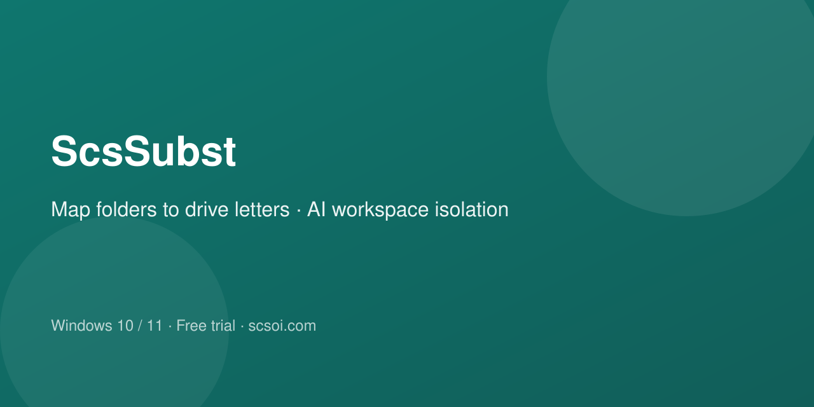

[English](README.md) · [中文](README.zh-CN.md) · [日本語](README.ja.md) · [한국어](README.ko.md) · **Español** · [Français](README.fr.md) · [Deutsch](README.de.md) · [Русский](README.ru.md)

  

<h1 align="center">ScsSubst</h1>

  <strong>Carpetas en letras de unidad</strong> 
  Dale a una carpeta profunda una letra — sin copiar, como un disco local.

  
  
  
  

  <a href="https://subst.scsoi.com/#download"><strong>Descargar</strong></a> ·
  <a href="https://subst.scsoi.com/#pricing"><strong>Precios</strong></a> ·
  <a href="https://github.com/shuyingegit/scssubst/releases"><strong>Releases</strong></a> ·
  <a href="https://drive.scsoi.com"><strong>ScsDriver</strong></a>

---

## ¿Por qué ScsSubst?

Dale a una carpeta profunda una letra — sin copiar, como un disco local.

¿Herramientas que escriben o borran y temes que toquen lo incorrecto? Dale una unidad de la que no salgan.

  

## Para qué sirve

- Carpetas habituales → letras
- Mantén las herramientas en una unidad
- Acorta rutas de proyecto largas
- Una unidad por espacio de trabajo

### Destacado: espacio de trabajo en sandbox más seguro

**Una unidad de la que no salga**

Cuando un software puede escribir o borrar de más, el riesgo es pasarse. Mapea una carpeta a una letra y deja la herramienta ahí.

1. Carpeta de trabajo dedicada
2. Mapear a letra (p. ej. Z:)
3. Workspace de la herramienta en Z:

> El workspace debe estar en esa unidad. Aislamiento práctico, no sandbox del SO.

  

## Características principales

Simple, estable, sin complicaciones.

- **Montaje con un clic** — Elige carpeta y letra, pulsa Conectar. Opcionalmente remonta al abrir la app.
- **Experiencia nativa** — Úsala en el Explorador como un disco normal — rutas más cortas.
- **Inicio automático** — Puedes remontar los perfiles guardados al abrir ScsSubst.
- **Ligero y estable** — Solo APIs de Windows — sin controlador de terceros. Portable ligero.
- **Varios mapeos** — Añade varios mapeos de carpetas, cada uno con su letra.
- **Opciones avanzadas** — Visibilidad para apps elevadas, Papelera, etc. Simple por defecto.
- **Prueba al instalar** — Prueba de 7 días; luego activa con licencia (mes / año / de por vida).
- **Unidad sandbox** — Las herramientas de escritura a menudo se pasan y borran lo incorrecto. Mapea una carpeta dedicada y apunta las herramientas ahí.

## Descargar

Últimas versiones: **[GitHub Releases](https://github.com/shuyingegit/scssubst/releases/latest)** · [Sitio web](https://subst.scsoi.com/#download)

| Paquete | Cuándo usarlo |
|--------|----------|
| **Portable (`.zip`)** | Descomprimir y ejecutar (recomendado) |
| **Installer (`.exe`)** | Instalador |

Requisitos: Windows 10 / 11 (64 bits)

## Precios

La prueba gratis empieza en 7 días. Invita a un amigo y ambos pueden alargarla.

Todos los planes (incluida la prueba gratis) incluyen soporte técnico: si tienes un error o problema, escríbenos al correo; lo investigamos, lo arreglamos y seguimos mejorando.

## Producto hermano

Monta WebDAV / nube como disco local en Windows.

→ **[ScsDrive](https://github.com/shuyingegit/scsdriver)** · [drive.scsoi.com](https://drive.scsoi.com)

## Preguntas frecuentes

**¿En qué se diferencia de montar la nube?**  
ScsSubst mapea carpetas ya en tu PC. Para nube/WebDAV usa ScsDriver (drive.scsoi.com).

**¿Cuál es la diferencia entre la versión de prueba y la con licencia?**  
Las funciones son las mismas. La prueba dura 7 días; con el código de un amigo pasa a 14. Si alguien empieza la prueba con tu código, tú también ganas 7 días, sin límite. Las licencias de por vida no suman días. Después hay que comprar.

**¿Cómo usar ScsSubst como espacio seguro en sandbox?**  
Crea una carpeta de trabajo dedicada, mapéala a una letra y apunta el workspace de la herramienta ahí. Los borrados accidentales se quedan en esa unidad. No es un sandbox a nivel de SO.

## Licencia y términos

Términos · Privacidad · Reembolsos — [https://subst.scsoi.com/terms](https://subst.scsoi.com/terms) · [https://subst.scsoi.com/privacy](https://subst.scsoi.com/privacy) · [https://subst.scsoi.com/refund](https://subst.scsoi.com/refund)

---

  <a href="https://subst.scsoi.com/"><strong>Abrir el sitio →</strong></a>

